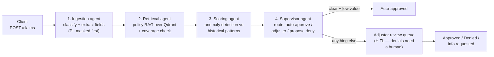
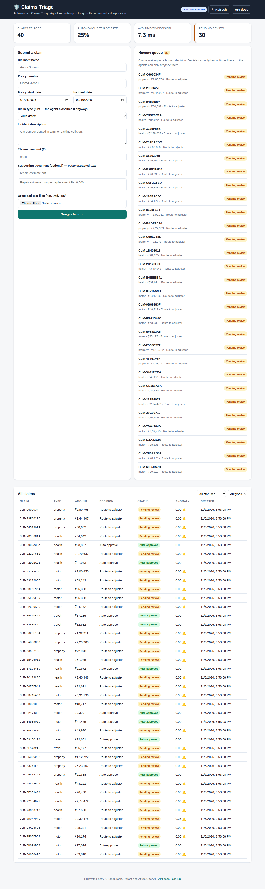
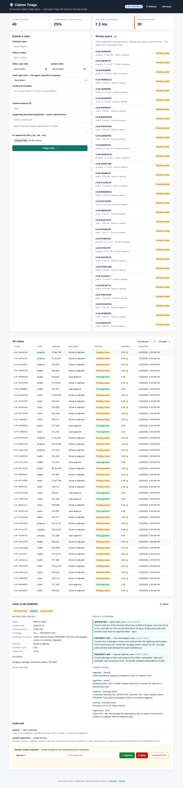
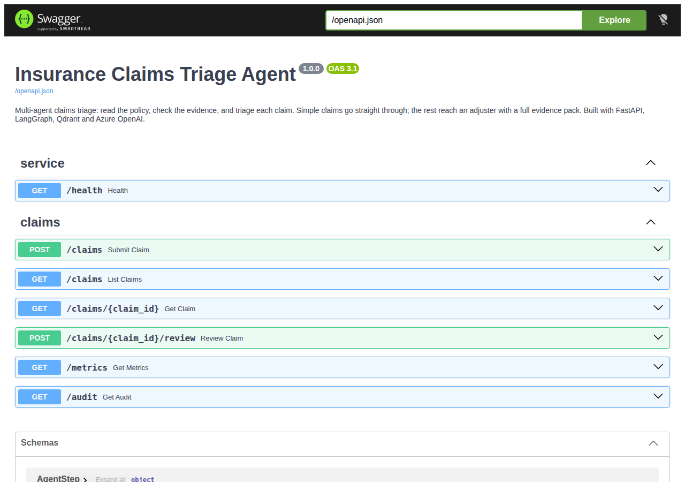
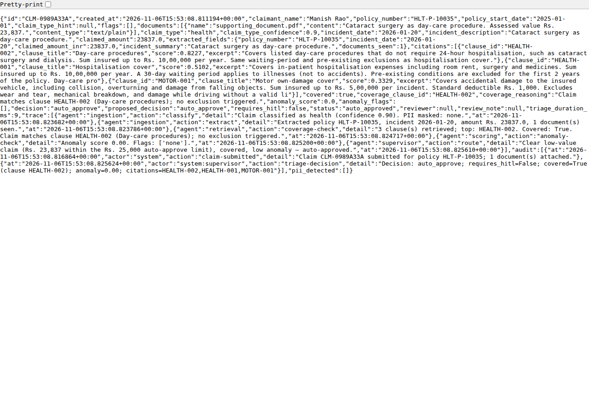
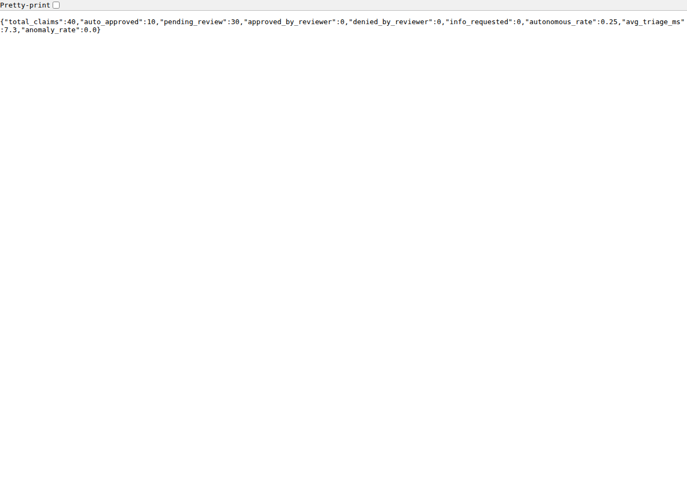

# ai-insurance-claims-triage-agent

> AI agent that triages insurance claims — document ingestion, policy RAG, anomaly scoring and human-in-the-loop review, built with LangGraph, FastAPI and Qdrant.

[](https://www.python.org/downloads/)
[](https://fastapi.tiangolo.com/)
[](https://langchain-ai.github.io/langgraph/)
[](https://github.com/ProNoob-Dev/ai-insurance-claims-triage-agent/actions/workflows/ci.yml)
[](LICENSE)

A claims team triages incoming claims by hand — reading FNOL forms, policy documents and photos, then deciding what is payable, what needs an adjuster, and what looks suspicious. Simple claims wait days behind complex ones.

This service does that triage with four cooperating agents: it reads the claim, checks it against the actual policy wording, scores it for anomalies, and routes it. **Clear low-value claims are auto-approved. Everything else reaches an adjuster with a full evidence pack. A denial is never final without a human confirming it.**

## What it does

- **Submit a claim** (`POST /claims`) with documents — the pipeline triages it in milliseconds and returns the decision, the policy clauses it cited, the anomaly score, and the full agent trace.
- **Auto-approve** clear, low-value, covered claims (default limit ₹25,000, configurable).
- **Route to an adjuster** anything high-value, anomalous, or unclear — with the evidence pack attached.
- **Propose denials, never finalise them** — an excluded claim (wear and tear, no valid licence, pre-existing condition…) is proposed for denial and held in the review queue until a named reviewer confirms it.
- **Audit everything** — every triage decision and every human review is written to the audit log with its citations, so any decision can be traced back to its source documents and policy clause.
- **Mask PII before any model call** — emails, phone numbers, Aadhaar, PAN and names are redacted before text reaches the LLM.

## How it works



| Agent | Job |
| --- | --- |
| **Ingestion** | Classifies the claim (motor / health / property / travel) and extracts structured fields — policy number, incident date, amounts — from the FNOL form and documents. |
| **Retrieval** | Searches the policy wording in Qdrant (or the in-memory fallback) and returns the top clauses with citations to the exact clause. Then assesses coverage against the best-matching clause. |
| **Scoring** | Flags anomalies: duplicate filings on the same policy, amounts far above the norm for the claim type, amounts above the clause limit, incident before policy start or in the future, missing documents, amount mismatches between documents. |
| **Supervisor** | Makes the routing decision. Auto-approves only when the claim is covered, low-value and low-anomaly. Everything else goes to a human with the evidence pack. |

The workflow is a real [LangGraph](https://langchain-ai.github.io/langgraph/) state graph (`app/agents.py`) — four nodes, one state, every step recorded in the claim's trace.

## Screenshots

Real captures of the app running locally (see [`scripts/screenshot.py`](scripts/screenshot.py) to regenerate them).

**Dashboard — overview, submit form, review queue and claims list:**



**Dashboard — claim detail with citations, agent trace, audit trail and review actions:**



**Interactive API docs** — Swagger UI, self-hosted (no CDN dependency, works offline):



**A triaged claim** — decision, citations, anomaly score, agent trace and audit trail in one response:



**Live metrics:**



## Quickstart

### Option A — Docker (recommended)

```bash
git clone https://github.com/ProNoob-Dev/ai-insurance-claims-triage-agent.git
cd ai-insurance-claims-triage-agent
docker compose up --build
```

- API: <http://localhost:8000>
- Interactive docs: <http://localhost:8000/docs>
- Qdrant dashboard: <http://localhost:6333/dashboard>

### Option B — local Python

Prerequisites: Python 3.12.

```bash
git clone https://github.com/ProNoob-Dev/ai-insurance-claims-triage-agent.git
cd ai-insurance-claims-triage-agent
python -m venv .venv && source .venv/bin/activate
pip install -r requirements.txt
cp .env.example .env        # optional — sensible defaults already apply
uvicorn app.main:app --reload
```

Open <http://localhost:8000> for the dashboard, or <http://localhost:8000/docs> for the API.

## Dashboard

The app serves a dashboard at `/` — no build step, no JavaScript framework, no CDN. Just open <http://localhost:8000>:

- **Overview** — claims triaged, autonomous triage rate, avg time-to-decision, pending reviews.
- **Submit a claim** — claimant, policy number, dates, claim type, description, amount, plus supporting documents (paste extracted text or upload `.txt`/`.md`/`.csv` files).
- **Claims list** — every claim with status badges (auto-approved, pending review, approved, denied, info requested) and anomaly scores; filter by status and type.
- **Claim detail** — extracted fields, policy citations, anomaly flags, decision + reasoning, the full agent trace and the audit trail.
- **Review queue** — everything waiting for a human decision, with **Approve / Deny / Request info** buttons wired to the review endpoint. Denials can only be confirmed here.

```bash
# 1. Submit a claim
curl -X POST http://localhost:8000/claims \
  -H 'Content-Type: application/json' \
  -d '{
    "claimant_name": "Aarav Sharma",
    "policy_number": "MOT-P-10001",
    "policy_start_date": "2025-01-01",
    "incident_date": "2026-03-10",
    "incident_description": "Car bumper dented in a minor parking collision.",
    "claimed_amount": 8500,
    "documents": [
      {"name": "repair_estimate.pdf",
       "content": "Repair estimate: bumper replacement Rs. 8,500"}
    ]
  }'

# 2. See it triaged (auto_approved), then list the review queue
curl http://localhost:8000/claims?status=pending_review

# 3. A human reviewer decides a pending claim
curl -X POST http://localhost:8000/claims/<CLAIM_ID>/review \
  -H 'Content-Type: application/json' \
  -d '{"decision": "approve", "reviewer": "adjuster-1",
       "note": "Verified with garage."}'

# 4. Metrics + audit log
curl http://localhost:8000/metrics
curl http://localhost:8000/audit
```

### Seed data

40 realistic sample claims and a labelled golden set of 20:

```bash
python scripts/seed.py            # regenerates data/sample_claims.json
                                  # and data/golden_set.json
python scripts/seed.py --submit   # POSTs all 40 to a running API
```

## API

| Method | Endpoint | Description |
| --- | --- | --- |
| `GET` | `/` | Service info |
| `GET` | `/health` | Health check |
| `POST` | `/claims` | Submit a claim → runs the full triage pipeline |
| `GET` | `/claims` | List claims (`?status=&claim_type=&min_amount=&max_amount=`) |
| `GET` | `/claims/{id}` | Full claim: decision, citations, trace, audit |
| `POST` | `/claims/{id}/review` | Human review: `approve` / `deny` / `request_info` |
| `GET` | `/metrics` | Totals, autonomous rate, avg triage time, anomaly rate |
| `GET` | `/audit` | Audit log (`?claim_id=`) |

Interactive docs at `/docs` (Swagger UI is vendored under `app/static/swagger-ui/`, so it works with no internet access).

## Evaluation results

The golden set (`data/golden_set.json`) is 20 labelled claims: 8 clear low-value auto-approvals, 8 adjuster routes (high value / complex), 4 exclusion cases that must only ever be *proposed* denials. Run it with:

```bash
pytest tests/test_evals.py -v
```

Results on this codebase (mock LLM provider, deterministic):

| Check | Result |
| --- | --- |
| Routing accuracy (correct auto-approve / adjuster / propose-deny) | **20/20 — 100%** (target ≥ 88%) |
| Final denials without a human reviewer | **0** (enforced in code, asserted in tests) |
| Decisions with ≥ 1 policy citation | **20/20** |
| Full test suite | **21 passed** (`pytest`), `ruff check` clean |
| Avg triage time (mock provider) | ~8 ms per claim |

## Configuration

All settings come from environment variables (see [`.env.example`](.env.example)). The important ones:

| Variable | Default | What it does |
| --- | --- | --- |
| `LLM_PROVIDER` | `mock` | `mock` (offline, deterministic) or `azure` |
| `AZURE_OPENAI_ENDPOINT` | — | Azure OpenAI endpoint (only for `azure`) |
| `AZURE_OPENAI_API_KEY` | — | Azure OpenAI key (only for `azure`) |
| `AZURE_OPENAI_DEPLOYMENT` | `gpt-4o` | Deployment name |
| `QDRANT_URL` | `http://localhost:6333` | Qdrant server; falls back to an in-memory vector store if unreachable |
| `AUTO_APPROVE_LIMIT_INR` | `25000` | Max claim value that can auto-approve |
| `ANOMALY_ROUTE_THRESHOLD` | `0.6` | Anomaly score at/above which a claim is routed to an adjuster |
| `PORT` | `8000` | API port |

**LLM providers.** The pipeline never calls a model directly — it goes through one `LLMProvider.complete()` interface (`app/llm.py`). The mock provider is the default: it implements the same prompts and JSON contracts as the real provider with deterministic rules, so everything runs, demos and tests with no API key. Set `LLM_PROVIDER=azure` with your Azure OpenAI credentials to use GPT-4o for classification, extraction and coverage assessment. If `azure` is requested but credentials are missing, the service falls back to the mock provider with a warning instead of crashing.

## Project structure

```
ai-insurance-claims-triage-agent/
├── app/
│   ├── main.py            # FastAPI app + routes (+ self-hosted /docs)
│   ├── agents.py          # LangGraph workflow: 4 agents, 1 state graph
│   ├── pipeline.py        # Orchestration + HITL review rules
│   ├── llm.py             # LLM provider interface: mock + Azure OpenAI
│   ├── vector_store.py    # Qdrant retrieval + in-memory fallback
│   ├── pii.py             # PII masking before any model call
│   ├── store.py           # Claim store + audit log (JSON)
│   ├── models.py          # Pydantic models
│   ├── config.py          # Settings from environment
│   ├── static/
│   │   ├── index.html       # Dashboard (vanilla HTML/CSS/JS, no build step)
│   │   ├── dashboard.css
│   │   ├── dashboard.js
│   │   └── swagger-ui/      # Vendored Swagger UI (MIT) — docs work offline
├── data/
│   ├── policy_clauses.json  # 11 policy clauses (motor/health/property/travel)
│   ├── sample_claims.json   # 40 sample claims (regenerate: scripts/seed.py)
│   └── golden_set.json      # 20 labelled eval cases
├── scripts/
│   ├── seed.py          # Generate seed data / submit it to a running API
│   └── screenshot.py    # Regenerate docs/screenshots with Playwright
├── tests/
│   ├── test_api.py      # HTTP round-trips
│   ├── test_pipeline.py # Routing, HITL enforcement, audit trail
│   ├── test_pii.py      # PII masking
│   └── test_evals.py    # Golden-set evaluation (acceptance criteria)
├── docs/screenshots/   # Real captures of the running app
├── .github/workflows/ci.yml
├── Dockerfile
├── docker-compose.yml   # api + qdrant
└── requirements.txt
```

## Development

```bash
pytest -v            # full suite, incl. golden-set eval
ruff check app scripts tests
python scripts/screenshot.py   # regenerate screenshots (API must be running)
```

CI (`.github/workflows/ci.yml`) runs lint + tests + an API smoke test on every push and pull request.

## Contributing

Contributions are welcome — see [CONTRIBUTING.md](CONTRIBUTING.md). Good first issues: more policy clauses, a real document-intelligence extractor (Azure Document Intelligence), and a Qdrant-backed eval report.

## License

[MIT](LICENSE)
